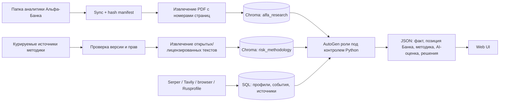

# Персональная новостная аналитика по обезличенным компаниям

## Назначение

Создать работающий веб-прототип для участников хакатона «Альфа Хак — Новостная аналитика». Пользователь выбирает компанию по синтетическому ID и получает подобранные для её бизнес-профиля новости, оценку влияния каждой новости и варианты действий. Backend отдаёт результат в структурированном JSON, frontend показывает его как новостную ленту и подробные карточки аналитики.

Так как в предоставленном датасете нет ИНН и названий, сервис не должен выдавать события реальных юрлиц за события выбранной синтетической компании. Персонализация строится на данных компании и её аналогах; реальные профили Rusprofile используются как явно обозначенная аналоговая база.

## Цели

- Принимать синтетический ID из `df_Uid_data_hack.csv` и собирать связанный сетевой контекст из `df_Fid_Uid_link_hack.csv`.
- Строить объяснимый профиль компании и определять её отраслевые/сетевые аналоги.
- Выполнять отдельный Serper News поиск для каждого синтетического ID.
- Ежедневно независимо от пользовательских запросов обновлять для каждого ID до 20 материалов за 90 дней и до 20 за 7 дней.
- При каждом запросе выбранной компании выполнять свежий поиск за последние 24 часа и возвращать до 10 материалов.
- Находить новости, корпоративные существенные факты, судебные дела и сигналы усиления контроля: проверки, штрафы, предписания и иные меры регуляторов.
- Для каждой новости отдельно определять горизонт влияния, классифицировать её как риск, возможность или смешанное событие, оценивать изменение бизнес-показателей в процентах и предлагать решения с отдельной процентной оценкой для каждого решения.
- Связывать факты, выводы и предложения с источниками, признаками компании и использованными аналогами.
- Использовать AutoGen с разными специализированными ролями при контролируемом приложением сценарии.
- Соблюдать список разрешённых LLM и остальные требования PDF.

## Не цели

- Устанавливать реальную личность компании по синтетическому ID.
- Приписывать синтетической компании судебное дело или сообщение Федресурса реального аналога.
- Представлять результат как аудированную финансовую модель, юридическое заключение или гарантированный прогноз.
- Использовать LLM, отсутствующие в разрешённом списке кейса.
- Делать произвольный автономный поиск или неограниченный групповой диалог агентов.

## Текущее состояние проекта

- Flask-сервер уже регистрирует `/api/news` и `/api/rusprofile`.
- `/api/news/search` и `/api/news/queries` сейчас завязаны на Tavily и текущую конфигурацию LLM.
- `SERPER_SEARCH.py` обращается к обычному Google Search endpoint и разбирает `organic`; режима News в нём пока нет.
- `PARSING/rusprofile.py` умеет выполнять авторизованный поиск Rusprofile и загружать профиль по ID с локальным состоянием браузера. Поиск компаний для аналоговой базы и их ранжирование потребуют отдельной логики.
- В репозитории есть Telegram-бот, но отдельного web frontend не обнаружено. Для первого прототипа предлагается использовать существующий Flask backend и добавить компактный web frontend на шаблонах Flask и обычном JavaScript/CSS.
- Описанные PDF файлы хакатонных CSV в проектной папке сейчас не найдены. Импортёр должен принимать их из конфигурируемого каталога; реальный end-to-end запуск по хакатонной выборке потребует самих файлов.
- Текущая модель по умолчанию DeepSeek v3.2 в разрешённом списке PDF отсутствует. Конфигурацию пайплайна нужно ограничить разрешёнными моделями и сделать ключ/endpoint настраиваемыми через окружение.

## Подходы и выбор

### Получение новостей

1. Искать все окна при каждом открытии страницы. Этот подход проще для раннего spike, но не удовлетворяет ежедневному независимому обновлению и затрудняет скользящую аналитику.
2. Ежедневно собирать и сохранять 90- и 7-дневные окна, а 24-часовое окно искать при каждом запросе. **Выбрано пользователем.** Такой режим соответствует заданной частоте обновления и даёт стабильную историю найденных материалов.

### Анализ и оркестрация

1. Один универсальный агент проводит весь анализ. Это дешевле, но хуже разделяет сбор фактов, оценку влияния и самопроверку.
2. AutoGen-агенты с отдельными ролями и общим структурированным состоянием. **Выбрано пользователем.** Приложение задаёт последовательность этапов, права инструментов, лимит вызовов и проверку результата; AutoGen используется как фреймворк для ролевых вызовов, а не как неограниченный автономный процесс.

### Поиск

Serper News — основной поиск новостей для временных окон. Tavily сохраняется как вспомогательный поиск для расширения запросов и поиска материалов/первичных документов, если это оправдано доступом и стоимостью. Browser/Playwright используется как ограниченный инструмент открытия найденных первоисточников и извлечения текста, а не как неконтролируемый агент.

## Входные данные и профиль компании

Импортёр читает схему из приложения PDF и валидирует обязательные поля.

Из `df_Uid_data_hack.csv` профиль использует, если поле присутствует:

- `SYNTHETIC_U`, тип и форма собственности;
- основной ОКВЭД и его название;
- возраст/стадию компании, выручку и градации численности;
- город, регион и `GROUP_ID`;
- банковские продуктовые признаки;
- ФТС-признак и страну, факторинг и прочие флаги воздействия.

Из `df_Fid_Uid_link_hack.csv` строятся связи физлиц с компаниями и платёжные рёбра `PAYER` → `BENEFICIARY`, сумма и число платежей. Синтетические физлица остаются только узлами графа и не передаются наружу как идентичность человека.

Детерминированный подбор аналогов внутри датасета сравнивает ОКВЭД, форму собственности, масштаб, возраст/стадию, географию, продуктовые и торговые признаки. Сетевые агрегаты показывают главные отрасли контрагентов, крупнейшие направления платежей и концентрацию зависимостей. Алгоритм сохраняет оценки по отдельным признакам и причину выбора аналога.

Для Rusprofile запрос строится по описанию отрасли, ОКВЭД, правовой форме, региону и диапазону масштаба. Из результатов выбираются публичные организации с максимально похожими доступными признаками. Так как синтетический ID не связан с конкретной реальной записью Rusprofile, совпадение считается аналогией, не идентификацией. Профиль, финансовая динамика и сущфакты таких организаций входят в аналоговый контекст только с ссылками и явной меткой.

## Планировщик новостей и временные окна

- Отдельный ежедневный worker запускает обновление для каждого известного `SYNTHETIC_U`, даже если UI не открывали.
- По каждому ID отдельно строятся и исполняются запросы по контексту компании и отраслевым сигналам. Поиск между разными ID не объединяется.
- Для 90-дневного и 7-дневного результата хранится дата публикации, время получения, оригинальный query, Serper result, ссылка и окно релевантности.
- При открытии страницы выполняется отдельный свежий поиск за последние 24 часа для выбранного ID.
- Внешние фильтры поиска дополняются проверкой даты в приложении. Непарсируемые даты не должны молча попадать в точные временные окна; они могут быть помечены как дата не подтверждена.
- Материал с одинаковым canonical URL или совпадающим отпечатком заголовка/источника хранится в общем архиве один раз и связывается с каждым релевантным ID отдельно. В каждой ленте допустимы перекрывающиеся карточки между окнами.
- Лимиты — до 20 результатов на 90 дней, до 20 на 7 дней и до 10 на 24 часа. Если поиск нашёл меньше, API возвращает фактическое количество и не придумывает недостающие карточки.
- Сигналы классифицируются как обычные новости, суды, регуляторные проверки/санкции, корпоративные существенные факты, отраслевые/макро события и материалы Альфа-Банка.
- Результаты Serper/Tavily — обнаружение и отбор публикаций, не полный реестр судебных дел или проверок. Показатели должны называться динамикой найденных публикаций/сигналов; для абсолютной статистики нужны полные структурированные источники.

Ежедневный сбор выполняется как отдельная команда/worker, запускаемая планировщиком окружения. Для прототипа хранилище предлагается сделать на SQLite из стандартной библиотеки Python, чтобы сохранить статьи, связи с компаниями, историю запусков и результаты анализа без обязательного сервера БД.

Поиск может выполнять несколько запросов на один ID: отдельно по основному ОКВЭД, отраслевым связям, судам, корпоративным фактам и регуляторным мерам. Лимиты 20/20/10 применяются к итоговой ранжированной и дедуплицированной выдаче для окна и ID в целом, а не к каждому подзапросу. История попыток хранит все найденные кандидаты, чтобы было видно, почему материал вошёл или не вошёл в видимую ленту.

## Мультиагентный workflow

Python-контроллер выполняет ограниченную последовательность AutoGen-ролей и передаёт между ними версионированные JSON-объекты:

1. **Company Context / Peer Analyst** — формирует профиль, аналоги и признаки, значимые для новостей; расчёт similarity остаётся детерминированным. Может искать общедоступный контекст отрасли и регионального рынка.
2. **Search Planner** — создаёт отдельный набор запросов для конкретного ID, трёх временных/тематических задач и категорий сигналов.
3. **News & Legal Researcher** — исполняет Serper News/Tavily запросы и при необходимости получает текст первоисточника через ограниченный browser tool.
4. **Evidence Classifier** — извлекает событие, субъект, отрасль, географию, даты и цитируемые факты; выделяет суды, регуляторные меры и сообщения о существенных фактах.
5. **Impact Analyst** — связывает событие с признаками профиля и аналогами, самостоятельно извлекает контекст из обеих Chroma-баз и общедоступного веб-поиска, присваивает риск/возможность/смешанный эффект, метрики и горизонт конкретной новости.
6. **Bank Research Analyst** — извлекает применимые выдержки из `alfa_research` и дополняет их общедоступным веб-контекстом, возвращая позицию Банка отдельно от внешних фактов и анализа AI.
7. **Risk Methodology Analyst** — использует `risk_methodology` и веб-поиск официальных методических материалов для оценки риска/возможности, сравнения действий, сценариев и допущений; методические источники не подменяют факты о событии.
8. **Action Analyst** — самостоятельно использует обе Chroma-базы и общедоступный веб-поиск, формирует несколько релевантных действий и отдельную оценку влияния каждого действия на KPI относительно сценария без действия. Если готовый проверенный план не складывается, объявляет пробелы и запускает через Python-контроллер совместную доработку профильными ролями.
9. **Critic / Source Checker** — проверяет ссылки поиском и открытием источников, поддержку выводов, конфликтующие даты, ошибочное приписывание событий и согласованность оценки; возвращает конкретные замечания для совместной доработки, пока план не пройдёт проверку или не будет установлен внешний блокер.

У каждого агента ограниченные инструменты и одна схема входа/выхода. Состояние содержит компанию, аналоги, найденные публикации, факты с provenance, промежуточные выводы, ошибки и счётчики повторов. Не допускается передавать свободный текст вместо структурированных фактов там, где можно передать JSON.

## Оценка влияния и проценты

Каждая новость получает независимые поля:

- `impact_type`: `risk`, `opportunity` или `mixed`;
- `severity`, `likelihood`, `confidence` и rationale;
- `horizon`: например, немедленный, квартал, 6–12 месяцев или конкретный период, выбранный анализом для этой новости;
- бизнес-KPI, направление и ожидаемое изменение в процентах: оценочный диапазон, а не одна псевдоточная цифра;
- описание способа экстраполяции, количество и ссылки на использованные аналоги, исходные показатели, допущения и доказательства.

Если нет baseline целевой синтетической компании, агенты экстраполируют по Rusprofile-аналогам и похожим компаниям из датасета. При слабом совпадении/малой выборке оценка всё равно формируется как сценарная экстраполяция, но диапазон расширяется, уверенность понижается, число аналогов и допущения явно показываются. Модель не утверждает, что наблюдаемая динамика аналога вызвана тем же событием; корреляция и экспертное предположение помечаются отдельно.

Каждое решение должно быть законченным планом исполнения, а не общим советом вроде «заказать у других поставщиков». План указывает конкретный объект и объём действия, исполнителя/ответственную роль, последовательные шаги, срок каждого шага, необходимые ресурсы, критерии завершения и запасной сценарий. Для закупок он должен связать номенклатуру/категорию с конкретным кандидатом-поставщиком: например, «для закупки A запросить КП у X, для закупки B — у Y», если это подтверждено источниками и подходит по региону и категории.

Названия поставщиков, товары, специализация, география и публичные условия должны подтверждаться веб-источниками с URL и датой. Данные аналогов могут помочь вывести категорию закупки и критерии выбора, но не доказывают, что такой поставщик уже обслуживает целевую компанию. Если ассортимент целевой компании неизвестен, это отмечается как допущение; план включает шаг проверки номенклатуры перед заказом. Если надёжного кандидата или факта не найдено, модель не выдумывает название: возвращает кандидатов с уровнем подтверждения либо конкретный шаг поиска/квалификации поставщика и явно указывает пробел данных.

Если первое решение не содержит проверенных деталей, Action Analyst формирует `solution_gap_report` с недостающими фактами, нужными источниками и ответственными ролями. Python-контроллер раздаёт адресные задания: Company Context / Peer Analyst уточняет категорию и аналоговую основу; Search Planner строит запросы; News & Legal Researcher и другие Analyst-роли ищут кандидатов/условия и открывают источники; Bank Research Analyst и Risk Methodology Analyst добавляют отраслевой и методический контекст; Critic / Source Checker независимо проверяет ссылки и соответствие кандидатов.

Результаты возвращаются как структурированные `candidate_evidence` с URL, датой, подтверждаемым утверждением, ограничениями и статусом проверки. Action Analyst собирает из них план и передаёт Critic. Если Critic находит пробелы, контроллер направляет на доработку только спорные пункты. По умолчанию проводится до трёх адресных поисково-проверочных циклов на решение; лимиты времени, вызовов инструментов и бюджета LLM общие для всего анализа. Первичная неспособность одного агента составить план является триггером совместной доработки, а не основанием вернуть общий совет.

План получает статус `verified` только когда существенные шаги, категория закупки, публичная применимость поставщика, сроки/критерии и ссылки прошли проверку. Публичный каталог может подтвердить ассортимент и регион обслуживания, но коммерческая цена, запас, мощность поставки и готовность заключить договор требуют RFQ/ответа поставщика; до их получения они маркируются `requires_confirmation`. Если после совместных циклов остался внешний или внутренний блокер, ответ включает максимально конкретный исполнимый план его снятия, список проверенных фактов, оставшиеся подтверждения и статус `conditional`/`blocked`. Непроверенный вариант не выдаётся как подтверждённый.

Каждое решение возвращает свой `expected_change_pct` по одному или нескольким KPI и сравнение с базовым сценарием «не предпринимать действие», а также предполагаемый срок, затраты/побочные эффекты, условия, критерии успеха, fallback и источники. Проценты основаны на данных аналогов и рассуждении модели, поэтому отображаются как сценарная оценка.

Минимальная форма готового плана в `solutions[]`:

- `objective` и `recommendation` — конкретный результат и выбранный вариант;
- `implementation_plan[]` — нумерованные шаги с действием, объектом/категорией, исполнителем, сроком, зависимостями и критерием завершения;
- `supplier_candidates[]` — кандидат, соответствующая номенклатура, география/соответствие, статус проверки и ссылки на подтверждающие источники;
- `resources`/`estimated_cost`, `risks`, `fallback_plan`, `success_metrics` и `verification_status` (`verified`, `conditional`, `blocked`);
- `expected_change_pct[]`, собственный горизонт, уверенность, допущения и `source_ids`.

Пример формы процентной оценки (значения здесь только иллюстрируют схему, это не прогноз для конкретной компании):

```json
{
  "impact_type": "risk",
  "horizon": {"label": "ближайшие 3 месяца", "start": "2026-10-25", "end": "2027-01-25"},
  "business_metric_impacts": [
    {
      "metric": "операционные расходы",
      "direction": "increase",
      "change_pct": {"min": 2, "max": 6},
      "confidence": "low",
      "baseline_basis": "медиана 6 Rusprofile-аналогов",
      "assumptions": ["аналоговый диапазон, не причинная оценка"]
    }
  ],
  "solutions": [
    {
      "objective": "Снизить рост расходов на сырьё в ближайшем квартале",
      "recommendation": "Проверить двух квалифицированных кандидатов по отдельным категориям закупки перед переносом объёма",
      "implementation_plan": [
        {
          "step": 1,
          "action": "Сверить фактическую номенклатуру и месячный объём категории A",
          "owner": "закупки целевой компании",
          "due_in_days": 5,
          "completion_criteria": "Утверждена спецификация и объём для запроса КП"
        },
        {
          "step": 2,
          "action": "Запросить КП у подтверждённого кандидата X для категории A и у кандидата Y для категории B",
          "owner": "закупки целевой компании",
          "due_in_days": 10,
          "completion_criteria": "Получены сопоставимые цены, сроки поставки и условия оплаты",
          "source_ids": ["supplier_src_1", "supplier_src_2"]
        },
        {
          "step": 3,
          "action": "Провести тестовую поставку победившего кандидата до переноса основного объёма",
          "owner": "закупки и контроль качества",
          "due_in_days": 30,
          "completion_criteria": "Качество, срок и полная стоимость соответствуют заданным порогам"
        }
      ],
      "supplier_candidates": [
        {
          "supplier_name": "X",
          "procurement_category": "категория A",
          "fit_rationale": "Публичный источник подтверждает поставку данной категории в нужном регионе",
          "verification_status": "publicly_verified_candidate",
          "source_ids": ["supplier_src_1"]
        },
        {
          "supplier_name": "Y",
          "procurement_category": "категория B",
          "fit_rationale": "Публичный источник подтверждает соответствующий ассортимент",
          "verification_status": "publicly_verified_candidate",
          "source_ids": ["supplier_src_2"]
        }
      ],
      "resources": ["спецификация закупок", "проверка качества"],
      "estimated_cost": {"amount": null, "currency": "RUB", "basis": "нужны коммерческие предложения"},
      "risks": ["Кандидат может не пройти проверку качества"],
      "fallback_plan": "Сохранить текущего поставщика для категории, не прошедшей тестовую поставку",
      "success_metrics": ["полная стоимость поставки", "соблюдение срока", "процент брака"],
      "comparison": "относительно сценария без действия",
      "expected_change_pct": [
        {"metric": "операционные расходы", "direction": "decrease", "change_pct": {"min": 1, "max": 3}}
      ],
      "horizon": {"label": "до 3 месяцев"},
      "confidence": "low",
      "assumptions": ["Номенклатуру и фактические объёмы нужно подтвердить до запроса КП"],
      "source_ids": ["supplier_src_1", "supplier_src_2"]
    }
  ]
}
```

Значения процентов являются гипотезой модели, даже когда калибруются по похожим компаниям. В UI рядом с ними обязательно показываются аналоговая выборка, её размер, базовый показатель и ссылки на подтверждающие материалы. Если база или аналогов мало, агенты всё равно строят оценку, но расширяют интервал и снижают уверенность.

## Аналитические материалы Альфа-Банка

В публичном списке папки кейса [на Google Drive](https://drive.google.com/drive/folders/15xZTLF1lZ65p6o5xpNA_fRbxjoV-UlG1) сейчас отображаются девять PDF:

- `Бонд_Бриф_14092026.pdf`
- `ALFA_Russian_Steels_1К21PreviewUpdate_15Apr2021.pdf`
- `ALFA-7M26.pdf`
- `ALFA-consumption.pdf`
- `ALFA-Macro_Insights-Policy_Rate_11Sep.pdf`
- `ALFA-macro_stat1H26.pdf`
- `FI_Strategy_3Q26_22072026.pdf`
- `Gold_digest_August26.pdf`
- `Inflation_tracker_02.pdf`

Проверено отображение списка и названий; скачивание содержимого файлов и необходимость Google API credentials ещё не проверялись.

Они индексируются отдельно от внешних новостей в Chroma store `alfa_research`. Импортёр синхронизирует файлы из Drive в локальный каталог, ведёт манифест Drive file ID, имени, версии/modified time, SHA-256 и времени индексации; неизменившиеся документы не векторизуются повторно. Для воспроизводимости корпуса каждая запись хранит исходный Drive URL и отпечаток файла.

PDF извлекается с сохранением страниц и заголовков. Документы разбиваются на небольшие фрагменты по разделам и страницам с перекрытием; длинные таблицы/графики индексируются с подписью и контекстом страницы. Каждый chunk хранит `document_id`, название, дату публикации, страницу, заголовок раздела, `source_url`, хэш, класс источника и язык. Исходный фрагмент возвращается агенту с точной ссылкой/страницей. Если извлечение текста не удалось, документ помечается как требующий OCR и не считается проиндексированным.

Для каждой новости retrieval выбирает выдержки по теме, отрасли, географии и механизму воздействия. Агент Альфа-аналитики возвращает отдельное поле `bank_view`: что говорится в исследовании Банка, когда оно опубликовано и к какому аспекту события относится. Выдержка не считается доказательством внешнего события; JSON маркирует её как `bank_research` и отдельно показывает анализ AI.

## Второе хранилище: методика рисков и бизнес-решений

Методические документы хранятся в отдельной persistent базе Chroma `risk_methodology`, физически отделённой от `alfa_research`. Эта база не содержит новостные факты или клиентские записи: она подсказывает агентам, как описать риск/возможность, оценить неопределённость, сравнить действия и отразить ограничения вывода. Её retrieval не подменяет источники события.

Предлагаемый курируемый набор источников:

- [ISO 31000:2018, официальный каталог ISO](https://committee.iso.org/standard/31000) — общая последовательность управления рисками: выявление, анализ, оценка, обработка, мониторинг и коммуникация. ISO указывает, что редакция подтверждена в 2023 году и остаётся текущей. Полный стандарт платный; в Chroma помещаются только открытое описание/образец или экземпляр, на который есть лицензия.
- [COSO Enterprise Risk Management](https://www.coso.org/enterprise-risk-management) — связь управления рисками со стратегией и результативностью предприятия. Полный framework и compendium не копируются из закрытых материалов; индексируются только разрешённые публичные страницы/материалы либо лицензированная копия.
- [The Orange Book, GOV.UK](https://www.gov.uk/government/publications/orange-book/the-orange-book-management-of-risk-principles-and-concepts) — открытое руководство по risk framework, appetite, оценке, контролю, мониторингу и использованию риска при принятии решений. Документ относится к госорганизациям Великобритании; его используют как методический ориентир, не как нормативное правило для российских компаний.
- [The Green Book 2026, HM Treasury](https://www.gov.uk/government/publications/the-green-book--2/the-green-book-2026) — структурированное сравнение вариантов, затрат/выгод/рисков, сценариев и неопределённости. Это методика оценки государственных инициатив; её используют для структуры сценарного сравнения действий, не для переноса государственных нормативов в бизнес.
- [NIST AI RMF 1.0](https://www.nist.gov/publications/artificial-intelligence-risk-management-framework-ai-rmf-10) и [NIST Generative AI Profile](https://www.nist.gov/publications/artificial-intelligence-risk-management-framework-generative-artificial-intelligence) — отдельный раздел базы для рисков AI-пайплайна: проверяемость, ограничения, человеческий контроль и управление рисками генеративной модели. Это не источник методики корпоративного отраслевого риска.
- [Federal Reserve SR 26-2, revised Model Risk Management Guidance](https://www.federalreserve.gov/supervisionreg/srletters/sr2602.htm) — дополнительный материал о контроле риска количественных моделей и их применимости. Документ опубликован в 2026 году, заменяет SR 11-7 и имеет банковскую сферу применимости; его не используют как универсальный стандарт оценки российских компаний.

Для источников хранится реестр с автором/организацией, типом документа, юрисдикцией, областью применимости, датой и статусом/версией, URL, лицензией и датой последней проверки. Устаревшая версия исключается из активного retrieval, но остаётся доступной в истории. Отдельно размечается, является ли источник общим руководством, государственным контекстом, банковским модельным риском или AI governance.

Запросы к двум Chroma базам выполняются раздельными retrieval wrappers. Каждый найденный фрагмент возвращается с пометкой `knowledge_store`, чтобы система не смешивала позицию Альфа-Банка, методическую рекомендацию и факт из новости. Embeddings выполняются через RouterAI `POST /api/v1/embeddings` моделью [`intfloat/multilingual-e5-large`](https://routerai.ru/models/intfloat/multilingual-e5-large): 1024 измерения, контекст 512 токенов, E5-префиксы `passage:` и `query:`. Текущая цена в каталоге RouterAI — 1,10 ₽ за миллион входных токенов; фактическая цена может изменяться. Alpha PDF excerpts и локальные методические конспекты отправляются RouterAI/его провайдеру для векторизации. Embedding-вызовы используют тот же RouterAI ключ, суточный бюджет и Wi-Fi-only egress, что и chat inference.

### Доступ ролей к Chroma

Доступ выдаётся через именованные инструменты AutoGen с широким read/search по двум корпусам для ролей, которым он нужен. «Полный доступ» для Impact Analyst и Action Analyst означает поиск и чтение любых документов и фрагментов в обеих коллекциях. Запись, удаление и переиндексация остаются отдельными операциями ingestion worker. Роли получают найденные фрагменты с происхождением и ссылками; передача секретов запрещена.

| Роль/компонент | `alfa_research` | `risk_methodology` | Веб-поиск и открытие страниц | Граница доступа |
|---|---|---|---|
| Company Context / Peer Analyst | Нет | Нет | Да: общий отраслевой и региональный контекст | SQL-профиль, синтетические связи и детерминированные аналоги. Во внешние запросы не передаются синтетические ID и закрытые платёжные сведения. |
| Search Planner | Нет | Нет | Нет | Получает только признаки профиля и классификатор тем; формирует запросы для News & Legal Researcher. |
| News & Legal Researcher | Нет | Нет | Да: Serper/Tavily и ограниченный browser tool | Ищет внешние новости, судебные и регуляторные сигналы, сущфакты; возвращает URL, даты и provenance. |
| Evidence Classifier | Нет | Нет | Нет | Работает с найденными публикациями и текстом первоисточников; классифицирует факты. |
| Impact Analyst | Полный поиск/чтение | Полный поиск/чтение | Да: общий поиск и открытие источников | Сам ищет подтверждения и контекст; разделяет факты, аналитику Банка и методику с provenance. |
| Bank Research Analyst | Чтение | Нет | Да: общий веб-поиск | Возвращает позицию Банка отдельно от внешних фактов, с документом, страницей, цитатой и датой. |
| Risk Methodology Analyst | Нет | Чтение | Да: поиск методических источников | Возвращает применённый принцип/шаг анализа и ссылку; сохраняет юрисдикцию и область применимости. |
| Action Analyst | Полный поиск/чтение | Полный поиск/чтение | Да: общий поиск и открытие источников | Ищет данные для альтернатив и условий, оценивает каждое действие относительно сценария без действия. |
| Critic / Source Checker | Проверка цитат по ID | Проверка цитат по ID | Да: поиск и открытие источников | Проверяет найденные ссылки, точные фрагменты Chroma, конфликтующие даты и поддержку выводов. |
| Web UI и API-пользователь | Нет | Нет | Нет | Получает только итоговый JSON и публичные ссылки; не может запрашивать коллекции напрямую. |
| Ingestion worker | Запись при индексации | Запись при индексации | Нет | Отдельный не-LLM процесс для загрузки/переиндексации после проверки источника, версии и прав. Удаление требует явной команды оператора. |

Веб-инструменты всех Analyst-ролей и Critic вызываются через общий server-side gateway. Перед внешним запросом он удаляет синтетические ID, идентификаторы связей и непубличные точные финансовые/платёжные значения; поиск строится на общедоступном описании отрасли, региона, темы и события. Запросы, URL и результаты сохраняются в provenance и кэшируются для дедупликации. Веб-цитаты проверяются открытием первоисточника; Chroma-цитаты проверяются по точным ID. Если фрагмент отсутствует, Critic возвращает `citation_not_found` и передаёт вывод на исправление. Python-контроллер формирует для каждой роли отдельный контекст и сохраняет ограниченную последовательность и бюджеты вызовов.

Для первого прототипа можно использовать `chromadb.PersistentClient` с отдельным каталогом каждой базы; [официальная документация Chroma](https://docs.trychroma.com/docs/run-chroma/cloud-client) описывает локальную персистентность как вариант для разработки. Для многопроцессного/серверного развёртывания выбирается Chroma server-backed client, а не совместная запись несколькими приложениями в локальный каталог. Структурированное хранилище приложения (синтетические профили, расписания, статьи, связи ID↔news, трассы и JSON-анализы) остаётся отдельной SQLite/PostgreSQL базой; Chroma содержит только document chunks и embeddings.



## JSON API и web интерфейс

Предлагаемые endpoints:

- `GET /api/companies` — список синтетических ID и кратких профилей для выбора.
- `GET /api/companies/{synthetic_id}/news` — ежедневно сохранённые 90/7-дневные окна плюс свежий поиск за 24 часа для выбранного ID.
- `GET /api/companies/{synthetic_id}/news/{event_id}` — подробности события, оценка влияния, решения, доказательства и provenance.
- `POST /api/companies/{synthetic_id}/analyze` — запрос повторного анализа выбранных найденных событий без перезапуска фонового исторического сбора.

Объект ответа содержит `company_id`, `generated_at`, `windows`, `events`, `industry_signals`, `peer_basis`, `sources`, `bank_view`, `risk_method_used`, `analysis_trace` и `warnings`. У события есть идентификаторы, заголовок/факты, дата, тип, источник/URL, окно, соответствующие признаки компании и аналоги, оценка влияния и `solutions[]` с самостоятельными KPI-процентами и статусом проверки. `analysis_trace` содержит краткую историю назначенных совместных заданий, ID доказательств и итоговых проверок без chain-of-thought. Для каждого retrieved chunk возвращаются `knowledge_store`, document title, page/section, source URL, version и excerpt. UI визуально разделяет данные/факт, аналитику Альфа-Банка, методику анализа и AI-оценку/решение. API остаётся источником истины; frontend не генерирует отдельные выводы.

## Модели, ключи и безопасность

- Разрешённый список LLM берётся из PDF: Gemma 4 26B A4B, GLM-5.3-Flash, Qwen3.6 35B A3B, DeepSeek-V4.1-Flash, Qwen3-VL-30B-A3B-Instruct, Kimi-K2.6. Нужны provider/API identifiers для подключения, они не заданы этим документом.
- Выбор модели вынесен в конфигурацию, но конфиг отвергает модель вне allowlist.
- API ключи Serper, Tavily и LLM хранятся только в окружении.
- Суточные расходы на вызовы LLM ограничены условиями кейса (500 ₽); общий бюджетный gate учитывает все роли, анализы и повторные проверки, а не только одного агента. При достижении лимита поиск и сохранённые результаты остаются доступны, а генерация новых оценок откладывается или использует сохранённую версию.
- Локальный Rusprofile storage state остаётся исключённым из Git; содержимое cookies никогда не пишется в журнал и не возвращается API.
- Инструменты поиска имеют фиксированные домены/таймауты/лимиты и журналируют tool name, query, company ID, время, статус и URL, не секреты.
- Содержимое веб-страниц считается недоверенным вводом: инструкции на страницах игнорируются; браузерный инструмент только читает и извлекает данные.
- Результаты показывают происхождение: факт источника, данные из хакатонного набора, материал Альфа-Банка, аналоговая статистика или вывод LLM.

## Ограничения и риски

- Без CSV невозможно проверить структуру реальной поставки, качество профиля и число доступных аналогов. Импортёр должен быть параметризуемым и показывать ошибки схемы.
- Без реальных реквизитов нет персональной юридической связи Rusprofile/Федресурса/суда с целевым ID; любые найденные организации — аналоги.
- Поисковая выдача ограничена top-N, ранжируется провайдером и может быть неполной или с датами, заданными относительным текстом.
- Судебные и регуляторные новости не измеряют все дела/проверки отрасли. Надёжный абсолютный trend требует отдельной полной структурированной базы.
- Выводы о процентном влиянии не имеют причинной гарантии; UI должен показывать их как диапазоны сценариев и раскрывать аналоговую основу.
- Полное обновление каждого ID отдельно увеличивает число запросов; ежедневный worker должен иметь лимиты, повторные попытки, состояние последнего успеха и отчёт о пропусках.
- Сейчас нет web frontend и хакатонных CSV в локальном проекте; это отдельные части последующей реализации.

## Проверка прототипа

Полный сценарий ручной проверки после реализации:

1. Загрузить синтетический тестовый CSV и выбрать ID в web UI.
2. Убедиться, что отобразились профиль, объяснение выбора аналогов и их источники.
3. Запустить worker и увидеть отдельные записи обновления 90- и 7-дневных окон для выбранного ID.
4. Открыть ID и убедиться, что выполняется свежий 24-часовой запрос и результат содержит не более 10 карточек.
5. Сверить, что перекрывающиеся окна не создают дубликат события в архиве и одновременно показывают событие в подходящих лентах.
6. Проверить JSON-схему, источники, классификацию сигналов, диапазоны KPI и индивидуальный горизонт каждой новости.
7. Проверить на синтетическом примере событие без точных финансовых данных: оценка должна строиться на аналогах, раскрывать basis/assumptions и понижать confidence при слабой выборке.
8. Проверить сценарии недоступности Serper, Rusprofile, браузерного источника и LLM без потери ранее сохранённой ленты.

## Открытые технические решения для реализации

- Уточнить точные названия файлов, разделитель и реальные схемы переданных CSV при их появлении.
- Подключить провайдера и API model IDs для разрешённого списка моделей.
- Проверить параметры Serper News для временных фильтров и реализовать строгую пост-проверку даты.
- Зафиксировать версию Chroma и ID embedding-модели RouterAI; сохранять model ID и размерность в метаданных коллекции, учитывать стоимость вызовов и переиндексировать базу при смене модели.
- Подтвердить машинную синхронизацию публичной Drive-папки; если Drive API потребует отдельные credentials, использовать локально скачанный каталог и manifest-based reindex.
- Зафиксировать конкретное время ежедневного запуска и часовой пояс; по умолчанию предлагается 06:00 Europe/Moscow.
- Согласовать лимит затрат/число LLM вызовов на один ID и критерии остановки самопроверки; по умолчанию максимум один повтор этапа критика для события.
- Создать страницу web-прототипа на Flask templates/static, если не будет отдельного предпочтения по frontend stack.
